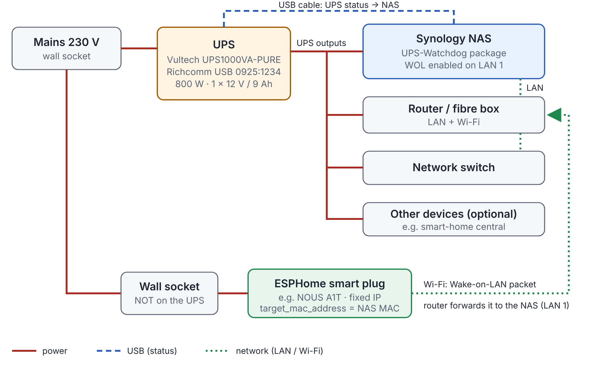
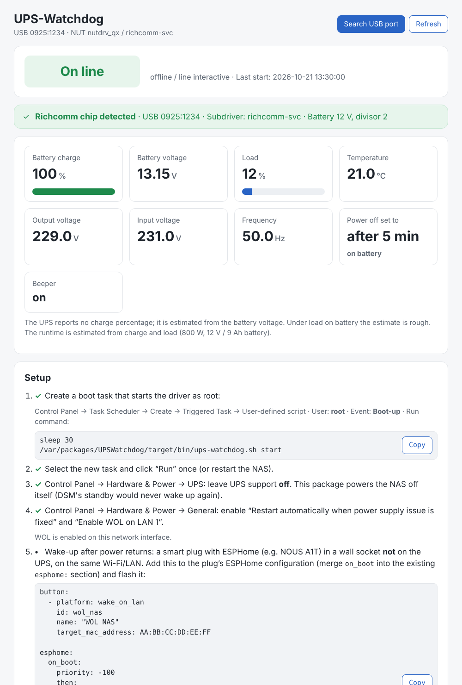
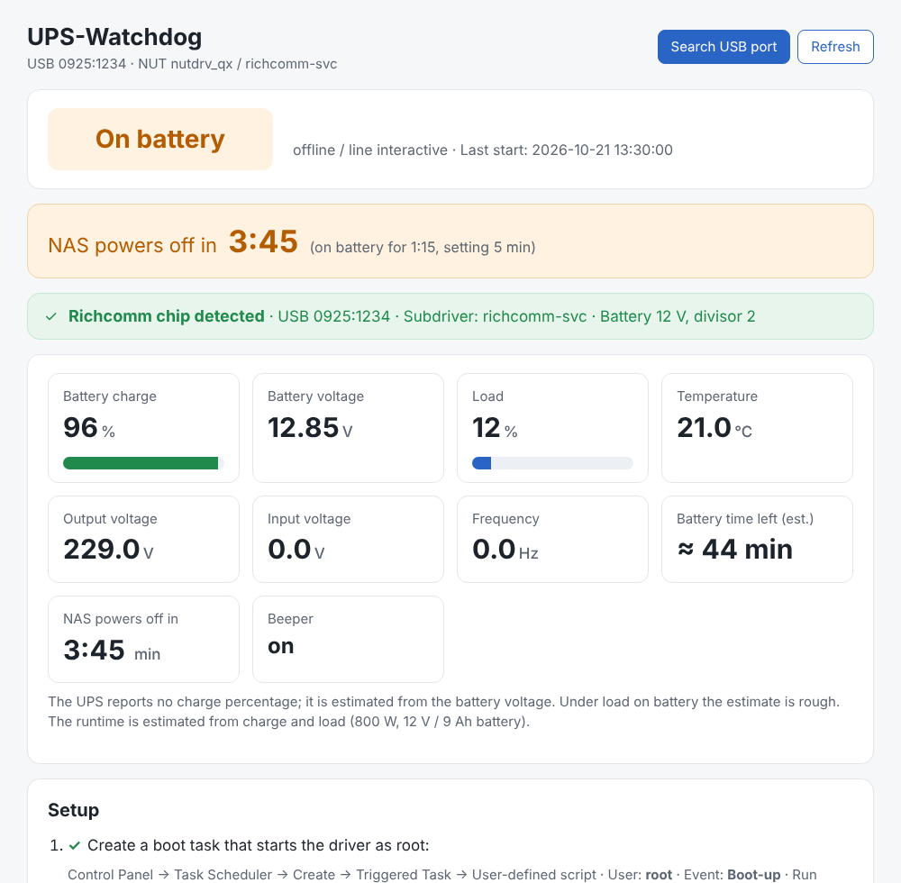
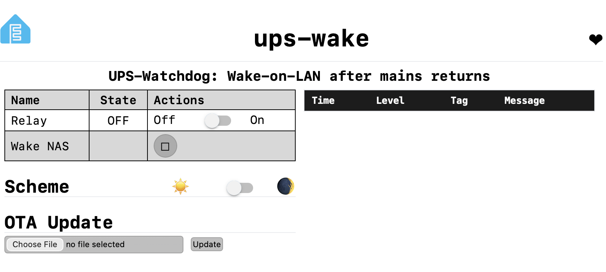

# UPS-Watchdog – Full Description

UPS-Watchdog is a Synology DSM package for USB UPSes with the Richcomm "UPS USB Mon V2.0" chip (USB 0925:1234), e.g. the Vultech UPS1000VA-PURE: after an adjustable time on battery it powers the NAS off cleanly, and a cheap ESPHome smart plug wakes it by Wake-on-LAN when mains returns. Tested end to end with version 3.0.2 on a DS923+ with DSM 7.3.

> **Warning – do not use DSM's Standby option.** Under Hardware & Power → UPS, DSM offers to put the NAS into Standby after a time on battery ("Time before Synology NAS enters Standby Mode", also in "Synology UPS server" mode). Do not enable it. In Standby the NAS hibernates: the volumes are unmounted, the services stop and it does not notice when mains returns. It stays in that state until it is restarted by hand. UPS-Watchdog therefore powers the NAS off completely instead, and Wake-on-LAN brings it back. The app shows a red warning when DSM's UPS support is switched on.

## System layout

The UPS powers the NAS and all network devices; only the ESPHome plug sits on a plain wall socket, so it is the first device to come back when mains returns.

Read it in three lines: **red** = power, the UPS feeds the NAS, router, switch and any other device that must stay on. **Blue** = the USB cable that carries the UPS status to the NAS. **Green** = network: NAS and switch on the router's LAN, the plug on Wi-Fi; its Wake-on-LAN packet reaches the NAS through the router.

## Components

Seven parts work together; only the driver, upsd and the watchdog run continuously, all as **root** on the NAS.

| Component | Runs where | Role |
| --- | --- | --- |
| UPS (e.g. Vultech UPS1000VA-PURE) | Hardware | 800 W line-interactive UPS, pure sine, 1 × 12 V / 9 Ah. Powers the NAS and the network devices. Talks over a Richcomm USB bridge (0925:1234). |
| `nutdrv_qx` driver | NAS, `/run/ups-watchdog/nutdrv_qx` | Static NUT build, subdriver `richcomm-svc` (fallback `armac`). Sets the bridge to 2400 baud and speaks Megatec Q1. Patch `battery_voltage_divisor`, because some models report a multiple of the real voltage. |
| `upsd` | NAS, DSM's own binary | Serves the UPS values on 127.0.0.1:3493 with a private config in `/run/ups-watchdog/nut`. `/etc/ups` stays untouched. |
| Watchdog (`ups-watchdog.sh watch`) | NAS, root loop every 5 s | Detects OB/OL/LB, counts down, powers the NAS off, restarts the driver and resets the USB port when the UPS stops answering. |
| Boot task | DSM Task Scheduler, root, Boot-up | Runs `ups-watchdog.sh start` 30 s after boot: copies binaries to `/run`, probes the UPS, starts driver, upsd and watchdog. |
| Status app | DSM main menu (package UI) | Shows status, countdown, estimated battery time, setup checklist, settings, log, documentation. |
| ESPHome smart plug (e.g. NOUS A1T) | Wall socket, not on the UPS | Boots when mains returns and sends Wake-on-LAN to the NAS every 30 s for about 10 minutes. |

Other devices on the UPS (router, switch, a smart-home central) keep running during an outage. They are the reason the UPS output must never be switched off, but they play no part in the UPS mechanics.

## Power-failure sequence

From mains loss to a running NAS again takes the set power-off time on battery (default 5 minutes) plus 3–5 minutes after mains returns; the network devices stay on the UPS throughout.

1. **t = 0 – mains lost.** The UPS switches to battery and reports `OB`.
2. **t ≤ 5 s – watchdog notices.** It stores the start time (`ob_since`), logs "on battery" and sends a DSM notification. The app shows the countdown and the estimated battery time.
3. **Mains back in time.** The UPS reports `OL`, the countdown is cancelled, DSM notifies "Power restored". Nothing else happens.
4. **t = 5:00 – power-off (parameter "Power off after").** The watchdog reads the status once more after 5 s (never acts on one reading), logs it and calls `synopoweroff`. DSM shuts down cleanly in 1–2 minutes. The UPS keeps the network devices running.
5. **Mains returns.** The ESPHome plug boots, waits for Wi-Fi (max. 5 min) plus 30 s, then sends a magic packet every 30 s, 20 times (about 10 minutes).
6. **NAS boots** on the first packet that arrives after its LAN port is up again.
7. **30 s after boot** the boot task starts driver, upsd and watchdog. The app shows "On line" again.

Two variants: with the setting **0 minutes** the NAS powers off only after two consecutive "battery low" readings. If the **battery runs flat** before mains returns, the UPS cuts its output; DSM's "Restart automatically when power supply issue is fixed" is then the backup that starts the NAS.

## Design decisions

Each choice below came from a failure seen on a real NAS; changing one of them brings that failure back.

| Decision | Reason |
| --- | --- |
| Native driver, no Docker | A static `nutdrv_qx` needs nothing installed on DSM and adds no container layer. |
| DSM's own UPS support off | In "Synology UPS server" mode DSM enters Standby. Standby unmounts the volumes and never resumes by itself when power returns. |
| Power off instead of UPS shutdown | `shutdown.return` would cut the UPS output and switch off router, switch and other devices too. The NAS is the only device that must go down. |
| Wake-on-LAN from a plug on the wall | A powered-off NAS cannot see mains return. A device on plain mains that boots with it must wake the NAS. |
| Runtime copy in `/run/ups-watchdog` | Driver and watchdog must keep running if the data volume that holds the package is unmounted. |
| Boot task as root | DSM 7 packages run as an unprivileged user. Only a root task can open the USB device, start upsd and power off. |
| Battery divisor patch | The tested UPS reports 26 V for its single 12 V battery. Without the divisor the charge estimate is wrong. |
| Confirm before power-off | One bad USB reading must never shut the NAS down: status is re-read after 5 s. |
| Watchdog survives updates (3.0.1) | A package update removes the package folder for a moment; the old watchdog took that as uninstall and quit. It now waits 2 minutes. |
| Automatic USB reset (3.0.2) | After a long outage the Richcomm chip hung until the cable was replugged. The watchdog now re-enumerates the port itself. |
| No caching of the app page (3.0.0) | The browser kept showing old content after updates. |

## App layout

The app is one page read top to bottom: status first, then values, then the setup checklist, settings and log; on battery a countdown appears directly under the status.

| Area (top to bottom) | Shows |
| --- | --- |
| Header | Name, USB ID, driver; buttons **Search USB port** (restart driver, USB reset if needed) and **Refresh** |
| Status card | Big badge: On line (green), On battery (orange), Battery low / No connection / Not signed in (red); UPS type and last start |
| Countdown card (only when needed) | On battery: "NAS powers off in m:ss" live. Red instead when the watchdog is not running or DSM's UPS support is on |
| Chip card | Richcomm chip detected (green) or not found (red); active subdriver, battery voltage, divisor |
| Value tiles | Charge %, battery voltage, load %, temperature, output and input voltage, frequency, beeper |
| Battery time tile (battery only) | Estimated time left, from charge and load |
| Power-off tile | On mains: the configured power-off time. On battery: the same live countdown |
| Setup checklist | Steps 1–5 with ✓ when done: boot task, run it, DSM UPS off, auto restart + WOL, ESPHome block with this NAS's MAC |
| Settings & log (folded) | Settings form, last 15 log lines, all UPS variables |
| Footer | Version, licence, Documentation, Request full description, Source |

Language follows the browser: German, English or French. The page refreshes every 5 seconds and is never cached.

## Configuration

One parameter matters most: how long the NAS may run on battery before it powers off (default 5 minutes).

### Package settings (app → Settings & log)

| Setting | Default | Note |
| --- | --- | --- |
| Power off after | 5 min | 0–999 min, parameter `SHUTDOWN_AFTER`; 0 = only at "battery low" |
| NAS LAN IP | auto | only needed with several network ports |
| Battery nominal voltage | 12 V | from the install wizard: 12 / 24 / 36 / 48 V |
| Battery voltage divisor | auto | corrects models that report a multiple of the real voltage |
| Battery full / empty | auto (13.1 V / 10.4 V per 12 V) | used for the charge estimate |
| Subdriver | auto (richcomm-svc → armac) | |

Settings are stored in `/var/packages/UPSWatchdog/var/settings`. Run the boot task again after saving; only then does the watchdog use the new value. Choose the time against your battery: with about 45 minutes of runtime, 20–30 minutes still leaves a safe reserve. A longer time avoids shutdowns on short outages but leaves less battery for the other devices on the UPS.

### DSM settings

- Control Panel → Hardware & Power → UPS: **off**.
- Control Panel → Hardware & Power → General: **Restart automatically when power supply issue is fixed** and **Enable WOL** on the LAN port that is connected.

### Wake plug firmware (NOUS A1T)

The NOUS A1T is sold with Tasmota pre-installed (ESP8266 family, 2.4 GHz Wi-Fi, 10 A, power meter). Tasmota has no Wake-on-LAN, so the plug is reflashed with the ESPHome firmware "ups-wake" in [`wake-plug/ups-wake.yaml`](../wake-plug/ups-wake.yaml). The board is an ESP8285; relay on GPIO14 (always off at start), status LED on GPIO13.

> **Adapt the MAC address.** `nas_mac` must be the MAC of **your** NAS – of the LAN port on which WOL is enabled. The value in the file is a placeholder. The UPS-Watchdog app shows the correct MAC in setup step 5; it is also in Control Panel → Network → Network Interface. With a wrong MAC the NAS stays off after a power failure.

The plug's ESP chip only works on **2.4 GHz** Wi-Fi; it cannot join a 5 GHz network. Change the setup network password (`wifi: ap: password`) before building.

### The plug's web page

After flashing, the plug "ups-wake" has its own web page at its IP address: relay switch, the **Wake NAS** button for a manual Wake-on-LAN, the live log and OTA update.

The relay can stay off: the plug only has to be powered to send the packets, nothing needs to be plugged into it. To test the network connection, toggle the relay: if it clicks and the state changes on the page, the plug is reachable over Wi-Fi. **Wake NAS** sends one magic packet at once – the quickest test that MAC and network are right.

### Flashing the plug (Tasmota → ESPHome)

Needed only for a new plug or after a reset; a firmware change on a working plug goes through its own OTA Update field.

1. Set `nas_mac` and the setup password, build the firmware with ESPHome (`esphome compile ups-wake.yaml`), then gzip it: `ups-wake-esphome.bin.gz`.
2. Tasmota web page of the new plug → Firmware Upgrade → upload the `.bin.gz`. After "Upload Successful" the plug restarts; the Tasmota page is gone.
3. About 1 minute later the Wi-Fi **UPS-Wake-Setup** appears. Connect, the setup page opens (otherwise 192.168.4.1), choose your 2.4 GHz network, enter its password, save.
4. Reserve a fixed IP for the plug in the router's DHCP, so its web page is easy to find.
5. Test: shut the NAS down, press **Wake NAS** on the plug's page; then unplug and replug the plug – the NAS starts after about 1–2 minutes.

The Wi-Fi password is not in the firmware: it is entered once through the setup network and stored in the plug. Side effect: the plug sends the wake packets after **every** restart, so unplugging it briefly while the NAS is off on purpose wakes the NAS.

## Install, update and test

An update is: install the .spk, run the boot task once, check the footer version; the test is to unplug the UPS for longer than the power-off time.

### First install

1. Package Center → Manual Install → `UPS-Watchdog-x86_64-<version>.spk`; choose the battery voltage in the wizard (12 V for one battery).
2. Task Scheduler → Create → Triggered Task → User-defined script: user **root**, event **Boot-up**, command `sleep 30` and `/var/packages/UPSWatchdog/target/bin/ups-watchdog.sh start`.
3. Select the task → **Run**.
4. Set the DSM options (Configuration → DSM settings).
5. Flash the wake plug (Configuration → Wake plug firmware).
6. Open the app: all setup steps show ✓.

### Update

1. Package Center → Manual Install → new .spk.
2. Task Scheduler → boot task → **Run** (activates the new watchdog version).
3. The app footer shows the new version. If the page looks old: open `http://<NAS-IP>:5000/webman/3rdparty/UPSWatchdog/index.html` and force a reload (Cmd+Shift+R / Ctrl+F5).
4. No red "Watchdog not running" banner.

### Test

1. Pull the UPS plug from the wall. The app shows "On battery" and the countdown within seconds.
2. After the set time the NAS powers off; router and switch stay on.
3. Plug the UPS back in. The ESPHome plug boots and the NAS starts within a few minutes.
4. After boot the app shows "On line" and the log has "powering the NAS off" and the new start.

Quick WOL test without a power failure: shut the NAS down, press "Wake NAS" on the plug's web page.

## Files and paths on the NAS

The package lives under `/var/packages/UPSWatchdog`; everything that must survive a volume unmount runs from `/run/ups-watchdog`.

| Path | Content |
| --- | --- |
| `target/bin/nutdrv_qx` | Static NUT driver (copied to `/run` at start) |
| `target/bin/ups-watchdog.sh` | start / stop / remove / status / watch |
| `target/ui/index.html` | Status app |
| `target/ui/status.cgi`, `settings.cgi`, `rescan.cgi` | App back end (needs the DSM login token) |
| `target/ui/doc.html`, `target/doc/README.md` | User documentation |
| `target/doc/wake-plug/ups-wake.yaml` | ESPHome firmware for the wake plug |
| `var/settings` | Settings saved from the app |
| `var/root.log` | Log (fallback `/var/log/ups-watchdog.log` when the volume is gone) |
| `var/root_state` | Last start: result, subdriver, divisor, IP, MAC, WOL, time |
| `var/ob_since` | Start of the current battery phase (exists only on battery) |
| `var/last_poweroff` | Time of the last power-off by the watchdog |
| `var/watch.pid` | PID of the running watchdog |
| `var/dsm_ups` | DSM UPS settings mirrored for the app |
| `/run/ups-watchdog/nut/ups.conf`, `upsd.conf`, `upsd.users` | Generated NUT configuration |
| `/usr/syno/etc/ups/synoups.conf` | DSM's UPS settings (read only) |

Useful commands over SSH (as root): `upsc ups@127.0.0.1` shows all values; `tail -f /var/packages/UPSWatchdog/var/root.log` follows the log.

## Troubleshooting and known limits

Most problems are a stopped watchdog or a hung USB chip; the app flags the first and fixes the second itself.

| Symptom | Cause | Remedy |
| --- | --- | --- |
| Red banner "Watchdog not running" | Boot task not run after an update, or task missing / not root | Task Scheduler → boot task → Run |
| On battery, no countdown, NAS stays on | Same as above (versions before 3.0.1) | Run the boot task; install ≥ 3.0.1 |
| "No connection – chip found, but the UPS does not answer" | Richcomm chip hung, e.g. after a long outage | From 3.0.2 automatic USB reset; otherwise replug the USB cable for 10 s or switch the UPS off and on |
| "No Richcomm chip found" | USB cable, UPS off, other UPS model | Check cable; click "Search USB port" |
| App shows old content after an update | Browser cache | Open the app URL directly and force a reload |
| NAS stays off after power returns | Wrong MAC in the plug, WOL off on the connected port, plug on the UPS, plug not in the LAN | Check the Configuration; test with "Wake NAS" |
| DSM in Standby that never ends | DSM's UPS support switched on | Switch it off |
| "Not signed in" in the app | App opened as a separate browser tab | Open it from the DSM main menu |

Known limits: x86_64 Synology models with DSM 7 only (check with `uname -m`); battery charge is estimated from voltage; battery time is an estimate from charge and load (800 W, 12 V / 9 Ah) and is rough under changing load.

## Version history

The current version is 3.0.3; the 2.0 redesign replaced DSM's standby with a clean power-off.

| Version | Date | Change |
| --- | --- | --- |
| 3.0.3 | 2026-10-21 | Driver rebuilt reproducibly from the published NUT patch and build script; project renamed synology-ups-watchdog |
| 3.0.2 | 2026-10-21 | Automatic USB reset when the UPS does not answer; user documentation and the wake-plug firmware in the package |
| 3.0.1 | 2026-10-21 | Watchdog no longer quits during a package update; red warning when it is not running |
| 3.0.0 | 2026-10-20 | App page no longer cached by the browser |
| 2.0.0-0023 | 2026-10-20 | On mains: configured power-off time; on battery: live countdown + battery time left |
| 2.0.0-0021 | 2026-10-20 | Setup step 5: ESPHome block with the NAS MAC |
| 2.0 | Oct 2026 | Redesign: DSM UPS support off, watchdog powers the NAS off, wake-up by WOL plug; package renamed UPS-Watchdog |
| 1.x | Oct 2026 | Driver with DSM "Synology UPS server" mode |
| 1.0 | Oct 2026 | First DSM package of the static driver |

## Sources and licence

- [Network UPS Tools](https://networkupstools.org) – `nutdrv_qx`, GPL-2.0-or-later
- [NUT #3667 – richcomm-svc subdriver](https://github.com/networkupstools/nut/issues/3667)
- [NUT #2219 – Vultech UPS1400VA-LFP, same chip](https://github.com/networkupstools/nut/issues/2219)
- [NUT #2738 – Vultech UPS2000VA-PRO](https://github.com/networkupstools/nut/issues/2738)
- [Gist by lvl47 – Accurat Flux 850, USB 0925:1234](https://gist.github.com/lvl47/a280c7d1a0a8a489c084c83b8f28f054)
- [ESPHome Wake-on-LAN button](https://esphome.io/components/button/wake_on_lan.html)
- [libusb](https://libusb.info) 1.0.27, LGPL-2.1

UPS-Watchdog is licensed GPL-2.0-or-later, © gkn202. No warranty – test power-off and wake-up with your own setup.

Synology and DSM are trademarks of Synology Inc.; Vultech, NOUS, Tasmota and ESPHome belong to their respective owners. They are named only to describe compatibility. This project is independent and not affiliated with, sponsored or endorsed by any of them.
